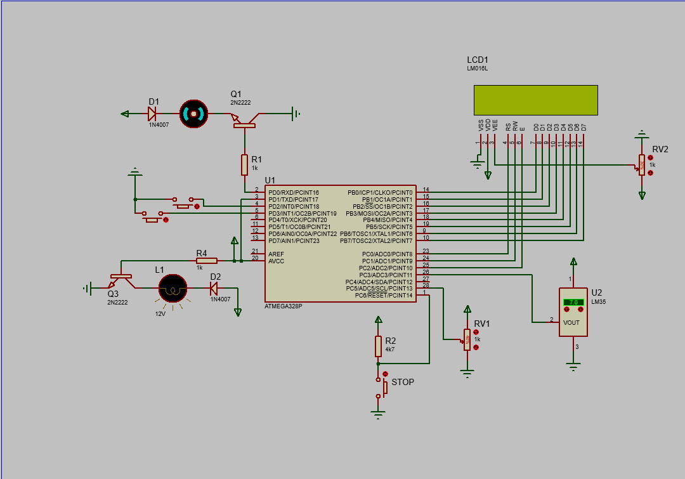

# ATmega328P Bare-Metal Embedded C

A progressive collection of **Embedded C exercises for the ATmega328P microcontroller**, moving from GPIO fundamentals to LCD interfacing, ADC, timers, interrupts, and an integrated temperature-control system.

The repository is intended as a practical reference for learning how microcontroller peripherals work at register level. Proteus project files and circuit screenshots can be paired with each exercise so that the code can be explored and simulated.

## Learning path

The exercises are arranged to build up concepts step by step:

1. **GPIO and digital I/O** — configure pins and control external components.
2. **LCD interfacing** — initialize a display and communicate using 4-bit or 8-bit modes.
3. **ADC and sensors** — read analog signals and use sensor input in a program.
4. **Timers** — configure a hardware timer to generate a square wave.
5. **Interrupt-driven programming** — respond to peripheral events without relying only on polling.
6. **System integration** — combine sensor input, processing, and output in a temperature-control example.

## Development environment

- **Target MCU:** ATmega328P
- **Language:** Embedded C
- **Simulation:** Proteus, for exercises that include a Proteus project
- **Toolchain:** Use an AVR-compatible compiler and development environment that supports the ATmega328P.

The exact clock frequency, compiler settings, and peripheral configuration should be checked in each source file and its corresponding circuit.

## Running an exercise

1. Open the `.c` file for the exercise you want to study.
2. Review the comments and identify the peripherals and pins used.
3. Compile the program for the **ATmega328P** using your AVR toolchain.
4. If a Proteus project is provided, open the corresponding project in Proteus.
5. Load the generated `.hex` file into the simulated microcontroller if it is not already configured in the project.
6. Run the simulation and compare the observed behavior with the program's intended behavior.

## Proteus simulations and screenshots

## Repository goals

- Provide readable examples of ATmega328P peripheral programming.
- Make it easier to connect Embedded C code with circuit behavior.
- Support practice and revision through small, focused exercises.
- Grow into a reference collection of source code, Proteus simulations, and visual results.

